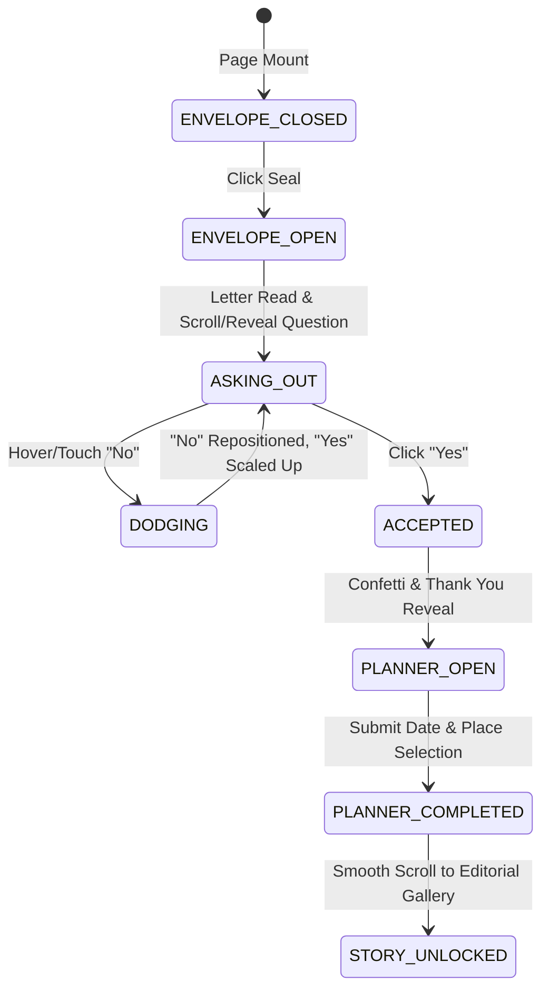

# Technical & Component Specification (spec.md)
*Project: Pinkie Birthday Multi-Year Architecture & 2026 Editorial Redesign*

---

## 1. Route Architecture & Directory Layout
```
src/
├── app/
│   ├── layout.tsx                     # Global Root Layout (Fonts, GlobalStyles, Theme)
│   ├── page.tsx                       # Primary 2026 Experience
│   ├── 2026/
│   │   └── page.tsx                   # Canonical 2026 Route (re-exports / aliases page.tsx)
│   ├── 2025/
│   │   ├── page.tsx                   # Archived 2025 celebration experience
│   │   └── components/                # 2025 components (isolated to avoid side effects)
│   │       ├── Introduction.tsx
│   │       ├── PhotoGallery.tsx
│   │       ├── HorizontalCarousel.tsx
│   │       ├── Letter.tsx
│   │       ├── MiraiLetter.tsx
│   │       └── ...
│   ├── components/
│   │   ├── navigation/
│   │   │   └── YearSwitcher.tsx       # Floating glass year pill (2025 vs 2026)
│   │   ├── 2026/
│   │   │   ├── HeroIntroduction.tsx   # Top section coordinator
│   │   │   ├── AnimatedEnvelope.tsx   # Origami letter unfold sequence
│   │   │   ├── PlayfulDecision.tsx    # Runaway "No" + Growing "Yes" buttons
│   │   │   ├── DatePlannerModal.tsx   # Calendar & itinerary organizer
│   │   │   ├── CalendarPicker.tsx     # Custom styled calendar & time picker
│   │   │   ├── LocationSearch.tsx     # Google Maps Places search + category chips
│   │   │   ├── RestaurantShowcase.tsx # Curated restaurant selection cards
│   │   │   ├── EditorialGallery.tsx   # Asymmetric magazine photo layout
│   │   │   └── Letter2026.tsx         # 2026 editorial letter & anniversary note
│   │   └── shared/
│   │       ├── BackgroundTexture.tsx  # Grain & paper texture canvas
│   │       └── FloatingPetals.tsx     # Organic petal animation
│   └── data/
│       ├── 2025/                      # Archived 2025 photos, wishes, data
│       │   ├── photos.ts
│       │   └── wishes.ts
│       └── 2026/                      # 2026 mock/live dataset
│           ├── restaurants.ts         # Pre-curated restaurants
│           ├── categories.ts          # Food categories
│           └── memories.ts            # 2026 editorial photos & quotes
```

---

## 2. State Machine: 2026 Interactive Introduction

### States


### State Store Structure (`useInvitationStore` or Component State)
```typescript
interface InvitationState {
  step: 'closed' | 'open' | 'asking' | 'accepted' | 'planning' | 'unlocked';
  noButtonOffset: { x: number; y: number };
  dodgeCount: number;
  yesButtonScale: number;
  planner: {
    selectedDate: Date | null;
    selectedTime: string;
    foodCategory: string | null;
    customLocation: string;
    selectedRestaurantId: string | null;
  };
}
```

---

## 3. Interaction & Animation Physics Specifications

### A. Runaway "No" Button Physics
- **Trigger**: `onPointerEnter`, `onTouchStart`.
- **Bounding Box Clamp**: Calculated dynamically against container bounds:
  - Width: `-min(220px, window.innerWidth * 0.35)` to `+min(220px, window.innerWidth * 0.35)`
  - Height: `-min(160px, window.innerHeight * 0.25)` to `+min(160px, window.innerHeight * 0.25)`
  - Safety margin prevents the button from flying off-screen or out of the viewport.
- **Framer Motion Transition**:
  ```typescript
  transition: {
    type: "spring",
    stiffness: 450,
    damping: 18,
    mass: 0.8
  }
  ```

### B. Growing "Yes" Button Dynamics
- Base scale: `1.0`.
- Increment per dodge: `scale += 0.12`.
- Upper clamp: `scale = min(1.65, 1.0 + dodgeCount * 0.12)`.
- Glow aura: Box shadow intensifies with scale (`0 0 ${12 + dodgeCount * 4}px rgba(231, 111, 142, 0.4)`).

---

## 4. Date Planner & Google Maps Integration

### Google Maps Places API Contract
- Use Next.js script loading for Google Maps JavaScript API with Places library:
  ```typescript
  // Load Google Maps script when planner opens
  // Safe Fallback: If GOOGLE_MAPS_API_KEY is not configured or offline,
  // gracefully fall back to local instant fuzzy-search of popular romantic venues.
  ```
- **Curated Featured Restaurant Schema**:
  ```typescript
  interface Restaurant {
    id: string;
    name: string;
    category: 'Japanese' | 'Italian' | 'French' | 'Fine Dining' | 'Dessert';
    rating: number;
    priceRange: '$$' | '$$$' | '$$$$';
    image: string;
    address: string;
    highlight: string;
  }
  ```

---

## 5. Automated Browser Verification via Playwright CLI
- Tool: `@playwright/cli` installed as devDependency.
- Verification Tests:
  1. `2025 Archive Route`: Verify `/2025` renders full 2025 gallery and letters without broken image links or styling bugs.
  2. `2026 Home Route`: Verify `/` loads the 2026 Editorial theme.
  3. `Interactive Decision`: Verify runaway "No" button moves on hover and "Yes" button triggers planner modal.
  4. `Mobile & Desktop Viewports`: Snapshot at `390x844` and `1440x900`.
